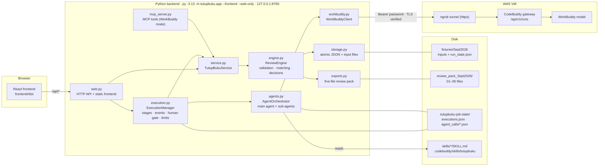
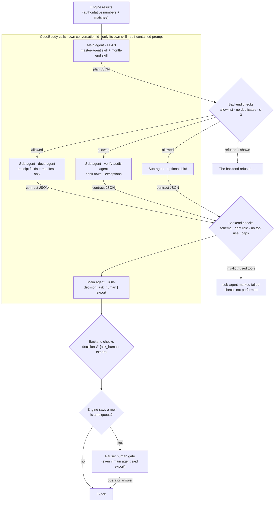
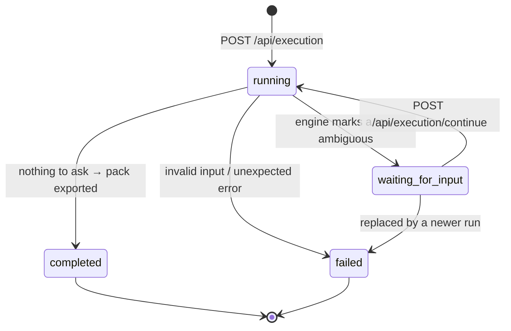

# TutupBuku backend architecture

One prompt in, one review pack out. The deterministic engine does every number; a main agent with
sub-agents (each a separate CodeBuddy call through the ngrok gateway) explains the evidence and asks
grounded questions; the operator settles what the records cannot; the pack is rebuilt from saved state.

## 1. Components



## 2. One run, end to end

```mermaid
sequenceDiagram
    autonumber
    actor Op as Operator
    participant UI as Frontend
    participant API as web.py
    participant EX as ExecutionManager
    participant EN as Engine
    participant OR as Orchestrator
    participant GW as CodeBuddy (ngrok)

    Op->>UI: "Prepare the month-end review pack…"
    UI->>API: POST /api/execution {case_id, goal, request_id}
    API->>EX: start()  (idempotent on request_id)
    EX-->>UI: run {status: running, version}
    loop every 700 ms
        UI->>API: GET /api/execution?run_id=
    end
    EX->>EN: inspect: get_case() → manifest + hashes
    EX->>EN: validate_case() → schemas, bank balance in sen
    EX->>EN: run_matching() → proposals + exceptions
    EX->>OR: review(case, matching)
    OR->>GW: main agent · plan
    Note over OR,GW: sub-agents run one after another by default (shared gateway session);<br/>TUTUPBUKU_PARALLEL_SUB_AGENTS=1 runs them in parallel
    OR->>GW: sub-agent · docs-agent
    OR->>GW: sub-agent · verify-audit-agent
    OR->>GW: sub-agent · (third, if chosen)
    OR->>GW: main agent · join → ask_human | export
    OR-->>EX: clipped result + audit file
    EX-->>UI: status waiting_for_input, question = row 41
    Op->>UI: picks INV-0912 / INV-0915 / neither + evidence
    UI->>API: POST /api/execution/continue {run_id, expected_version, …}
    API->>EX: resume() → save_decision()
    EX->>EN: run_matching() again, build_review_pack()
    EX-->>UI: status completed, pack: 5 files
    Op->>API: GET /api/exports/01_proposals.csv …
```

## 3. Main agent and sub-agents (who controls what)



## Known gateway limitation

The real eval (3 runs, 12 calls) showed that the CodeBuddy gateway returns the same `sessionId` for every
call, whatever conversation id we send. The agents therefore share one conversation history inside
CodeBuddy, across runs too. In one run two parallel sub-agents' replies arrived mixed. The backend now
runs sub-agents one after another, keeps only the reply object for the role it asked, tells every agent to
ignore earlier messages, and reports the shared session in the run. True isolation needs a gateway that
starts a new session per conversation; that is a VM-side setting to check.

## 4. Controls enforced by code

| Control | Where | Effect when broken |
| --- | --- | --- |
| Engine owns arithmetic, matches, exports | `engine.py` | Agents only read results; nothing they say changes a match |
| Sub-agent allow-list, no duplicates, at most 3 | `agents.py · parse_plan` | Refused and shown as an event |
| At most 5 gateway calls per run | `agents.py · MAX_CALLS` | Extra steps never sent |
| Run deadline (600 s default) | `agents.py · _call` | Later calls not made; `RUN_DEADLINE` disclosed |
| No tool use in this mode | `agents.py · _call` (gateway `toolCalls`) | Reply discarded; `AGENT_USED_TOOLS` |
| JSON schema on every reply | `parse_plan / parse_sub / parse_join` | Step failed and disclosed, never guessed |
| Reply must belong to the role that was asked | `agents.py · _call(expect=…)` | A reply mixed with another agent's output keeps only its own object (`ok_extracted`); none means failed |
| Shared gateway session | `agents.py · review` (session ids) | Disclosed in the run; sub-agents run sequentially; every prompt says to ignore earlier messages |
| Output caps (summary 400, 6 findings, 3 questions) | `execution.py · clip_review` | Clipped, "Output limited" note |
| Hourly agent limit (10 runs/hour) | `execution.py · start` | Run continues engine-only, disclosed |
| Human gate | `execution.py · _after_review` | Code pauses on ambiguity whatever the agent says |
| Stale answer protection | `resume(expected_version)` | 409, reload |
| Idempotent start | `request_id` | Replays the same run |
| Untrusted evidence | prompts mark EVIDENCE as data | Hostile receipt text reported, not followed |
| Gateway URL | `workbuddy.py · _private_gateway_url` | Only loopback or https ngrok; no credentials, paths |
| Secrets | `.env` (git-ignored) | Password only in the Authorization header |

## 5. Run states



Stage list shown in the UI: `inspect → validate → match → review → export`, each `queued | running | waiting | completed | failed`.

## 6. What is saved, and where

| Data | File | In git |
| --- | --- | --- |
| Synthetic inputs (baseline) | `demo-fixtures/Sept2026/` | yes |
| Working inputs + `run_state.json` (receipt fields, decisions, hashes) | `fixtures/Sept2026/` | yes (reset with `scripts/generate_fixtures.py`) |
| Runs: stages, events, clipped agent result | `.tutupbuku-job-state/executions.json` | no |
| Every agent call: prompt SHA-256, raw reply, timing, session, tool use | `.tutupbuku-job-state/agent_calls/<run_id>.json` · `GET /api/execution/audit?run_id=` | no |
| Eval reports | `.tutupbuku-job-state/eval/` | no |
| Review pack | `review_pack_Sept2026/` | no |

## 7. HTTP API

| Method + route | Purpose |
| --- | --- |
| `GET /api/cases`, `GET /api/case?case_id=` | Cases and source manifest |
| `POST /api/execution` | Start a run `{case_id, goal, request_id}` |
| `GET /api/execution[?run_id=]` | Poll the run |
| `POST /api/execution/continue` | Answer `{run_id, expected_version, candidate_id, answer, leave_open}` |
| `GET /api/execution/audit?run_id=` | Per-call agent audit |
| `GET /api/exports/<file>?case_id=` | Download a pack file (only when current) |
| `GET /api/source/<path>?case_id=` | Open an allow-listed source file |
| `GET /api/health` | Liveness |
| `POST /api/run`, `/api/decisions`, `/api/build-review-pack`, `/api/uploads`, `/api/reset-demo`, `/api/jobs` | Lower-level routes (WorkBuddy MCP mode, tests) |

## 8. Tests

| Suite | Covers |
| --- | --- |
| `test_engine`, `test_exports` | Spec cases T1–T10: matching rules, ±7 days, duplicates, prior period, unsupported allocation, invalid input, rebuild, hostile receipt, changed fixture |
| `test_web_flow`, `test_mcp_tools`, `test_mcp_protocol` | Lower-level API, uploads, MCP tools |
| `test_workbuddy_client`, `test_workbuddy_skill` | Gateway client protocol, skill safety statements |
| `test_execution` | One goal → pause at row 41 → answer → five files; leave open; neither; stale version; invalid input; HTTP endpoints; frontend serving |
| `test_execution_gateway` | Main agent + sub-agents over the gateway protocol (test double): order, parallelism, own skill and evidence per agent, refused plans, broken sub-agent, human gate, invalid decision, clipping, wrong password, audit, tool use rejected, deadline, hourly limit |
| `scripts/eval_agents.py` | Real runs through ngrok, reported as counts |
