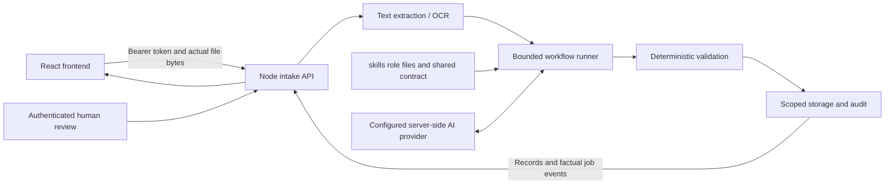

# Frontend and skills integration design

**Date:** 2026-10-11, Asia/Kuala_Lumpur.
**Status:** Planning handoff for Luna 6. No implementation or runtime validation has been performed for this integration.
**Scope confirmed by the user:** Connect purchasing and claims end to end: uploads, agent progress, documents, issues, and review actions. This planning session may write instructions only; Luna 6 is the intended implementer.

## Current evidence

- `frontend/` contains a React 18, TypeScript, Vite application with `/`, `/documents`, and `/issues` routes. The entire directory is untracked at the start of planning. Preserve it.
- `frontend/src/lib/agent.tsx` uses prepared extractions and filename heuristics, processes only the first selected file, and calls the browser record store. Its timers are not real agent progress.
- `frontend/src/state/store.tsx` seeds example documents and stores records, issues, decisions, and audit entries in `localStorage` under `tutupbuku.records.v2`. These are sample records, not backend accounting data.
- `frontend/src/lib/execution.tsx` targets an older Python bank-matching API on port 8765. It is a different workflow from the nine purchasing/claims skills. `frontend/README.md` also contains outdated descriptions of session persistence and page tabs.
- `skills/` contains nine role definitions and `skills/_shared/agent-contract.md`. Markdown files are instructions; a server-side loader, agent runner, provider, and deterministic workflow engine must execute them.
- Current HEAD is `e64a3e8`. Commit `397b378` removed runtime files as well as the former UI. Its parent `20408b7` contains the Node intake engine under `src/`, `scripts/smoke.js`, and `supabase/migrations/001_agentic_intake.sql`.
- The current Node tests describe this engine, but the required source is absent from HEAD. Python tests and several legacy UI/demo/proxy tests also refer to absent artifacts. Their presence is not proof of a working application.
- The historical Node engine already provides upload, authentication, job status, corrections, reprocessing, human issue resolution, approval, master data, and draft exports. It lacks some actions currently simulated by React and needs protection against stale analysis after edits/reprocessing.

## Selected architecture

Restore the historical Node intake backend selectively, retain the current React frontend, and use same-origin authenticated HTTP calls between them. The backend explicitly loads the nine skills from the repository; React never interprets or executes skill Markdown.

This reuses the engine that matches the existing skills and tests. Extending the older Python case workflow would mix incompatible contracts. Calling a general agent gateway from the browser would omit the application's storage, validation, and authorization boundary. Neither alternative is selected.

The initial supported path is local development: Node on `127.0.0.1:3000`, Vite on `127.0.0.1:5173` with `/api` proxied to Node. The Node server also serves built `frontend/dist` with SPA route fallback. Supabase compatibility must be maintained through mocked tests and authored migrations; provisioning or applying cloud migrations is a separate operation.

## Global requirements

1. Preserve the current React layout, navigation, typography, and orbit. Make functional integration changes and the minimal sign-in/setup controls required by the workflow. Do not restore the removed `public/` UI.
2. Use Node.js 22 or newer for the intake backend. Keep backend runtime dependencies limited to Node built-ins unless a demonstrated integration need requires otherwise. React remains React 18 with the existing Vite/TypeScript toolchain.
3. Every business data request requires a bearer token. The backend derives business and actor identity from verified authentication; requests never select a business or claim actor by browser-supplied identity.
4. Access tokens belong in tab-scoped `sessionStorage`, never `localStorage`. Clear live data, in-flight work, and credentials on sign-out or 401. Local email-only sign-in is explicitly labeled development-only; production uses Supabase Auth and HTTPS.
5. Owners and reviewers can review and approve. Only owners can edit company reference data. Employees can submit and see only their own claims and cannot access purchasing or reviewer actions. Unknown membership roles fail closed.
6. Support CSV, TSV, TXT, PDF, PNG, JPG, JPEG, and WEBP files, at most `15 * 1024 * 1024` bytes per file. Validate content as well as extension. Process every selected file as its own server job.
7. Default to automatic content-based routing. Explicit manual routing preserves the user's choice and flags conflicts. Employees submit explicit claims. Never classify a live upload by filename alone.
8. Money is integer MYR sen. Dates are date-only ISO strings; display locale is `en-MY`. Missing amounts, identifiers, confidence, and sources remain missing, not fabricated zeroes, IDs, percentages, or evidence.
9. Keep purchasing chains in Quotation > PO > DO > Invoice > Payment Advice > Receipt order for presentation, while supporting out-of-order uploads and bounded parallel checks.
10. Persist originals privately and preserve provenance for extracted fields, line items, findings, generated descriptions, PO links, and human decisions. Never expose storage keys or filesystem paths in responses.
11. A claim with a fuel receipt and `Lunch with Company X` remains held for clarification. Do not run category/writing stages while relevance is unresolved. Council opinions use three independent perspectives and active business account codes only.
12. Agents propose. Deterministic code validates arithmetic, identity, duplicates, accounts, and cumulative PO consumption. Only authenticated human actions resolve/dismiss findings or approve records; a completed AI job never approves anything.
13. Corrections invalidate the previous analysis for approval/export and increment `inputVersion`. Recheck does not automatically resolve old findings. New or repeated contradictions reopen the affected finding with audit history.
14. Every execution generation has a server-generated `runId`, captured `inputVersion`, job identity, and worker ownership. Stale outputs cannot overwrite a newer edit or run, and approval requires the analyzed version to equal the current input version.
15. Progress comes from persisted server events. No synthetic timers or percentage completion. Polling, page loading, sign-in, and status recovery never dispatch model calls.
16. Persist retry keys and correlate them to payloads. A network-uncertain upload retries the same bytes/metadata with the same key; a changed payload with the same key is rejected. Reprocessing is an explicit action, never an automatic response to a status-read error.
17. Missing AI configuration, OCR dependencies, master data, malformed outputs, timeouts, unavailable storage, and uncertain accepted model calls have explicit recovery states. Failed checks are never presented as passes.
18. Treat uploads and OCR text as untrusted evidence. Keep AI credentials, gateway passwords, database service keys, and provider errors server-side. The fixed AWS connection demo is not a general accounting API.
19. Live records start empty and come from backend storage. Do not import `tutupbuku.records.v2` or sample claims into live storage. Retain old browser data without treating it as current records; sign-out must not leave another user's live data visible.
20. Keep the old Python month-end modules outside the default intake provider tree. Default intake pages must make no `/api/cases`, `/api/case`, `/api/execution`, or `/api/exports/*` calls. Reimplementing bank matching is outside this scope.
21. Preserve existing user files, accounting artifacts, `.env` values, and `.tutupbuku-data/` contents. Use disposable directories for verification. Do not deploy, apply migrations, make paid model calls, or send prompts to another chat during this planning task.

## Integration contracts

Preserve existing intake endpoints and their response shapes where already asserted by `test/api.test.js`. Add an authenticated `GET /api/workspace` read model for the React store, authenticated original-file download, and a reviewed-action endpoint for the UI actions the old backend does not implement. Use a single backend projection from stored domain entities to React view models; avoid independent business logic in the browser.

The workspace returns `schemaVersion: 1`, a monotonic business `revision`, `docs`, `links`, `claims`, `issues`, `audit`, `masterData`, and role-derived `permissions`. It comes from one coherent scoped storage snapshot. Source references stay structured. UI view models retain raw processing/review state and per-entity versions alongside display labels.

`receipt` maps to `claim_receipt` only for workflow `claim`, otherwise `payment_receipt`. Backend workflow `claim` maps to frontend flow `claims`. Severity `error` maps to `HIGH`; finding `needs_review` maps to `UNDER_REVIEW`. Agent `confidence` values `high|medium|low` are not invented numeric percentages. `completed` means processing finished and remains pending human approval. Purchasing exportability requires explicit approval, not the existing browser `autoVerify` rule.

Review actions use a stable request ID, an expected business revision, and relevant document input versions. A conflict returns 409 and requires a read-only refresh before resubmission. Each command atomically validates scope/role/version, writes its changes and audit entries, and returns the updated revision plus an optional recheck job. Existing mutation routes delegate to the same guarded domain operations; they must not offer a bypass.

## Required user flows

- Sign in, load role and workspace, and configure the business's accounts/suppliers/buyer profile if authorized. Setup has no fabricated default master data.
- Submit purchasing documents or claims with the actual upload and stated purpose. See one job per file and factual named agent progress. Recover server jobs after reload without submitting the uploads again.
- Inspect resulting documents, purchasing links, field provenance, line comparisons, claims, issues, and original source files across the three existing routes.
- Correct extracted fields/prices, clarify claim purpose, confirm a PO, retain/mark a duplicate, change allowed category/description, and request rechecks. Reviewers explicitly resolve/dismiss/reopen issues with a reason, and approve or reject claims/documents under server-enforced rules.
- Export reviewed purchasing invoices and approved claims from the backend with date filters. Pending/rejected/stale records are excluded from these reviewed exports. The existing all-records draft export remains a separately labeled draft.

## Verification and completion

Luna must demonstrate both purchasing and claims through the HTTP boundary, with mocked AI outputs for automated tests. Test source-backed price/supplier/missing-DO findings, out-of-order uploads, claim purpose mismatch, independent council opinions, human correction/recheck/resolution/approval/rejection, role isolation, retry deduplication, stale responses, persistence after reload/restart, and reviewed export restrictions.

Frontend build, required intake tests, browser flow tests, static routing, and the local smoke test must pass. Report the whole-repository baseline separately: absent legacy Python/demo/proxy artifacts may cause unrelated failures and must not be hidden or described as passing. Mock provider success proves integration behavior, not live OCR/model/cloud behavior. A live provider demonstration requires the actual configured provider and separately reported final results.

The corresponding task-by-task instructions are in `../plans/2026-10-11-frontend-skills-integration.md`.
